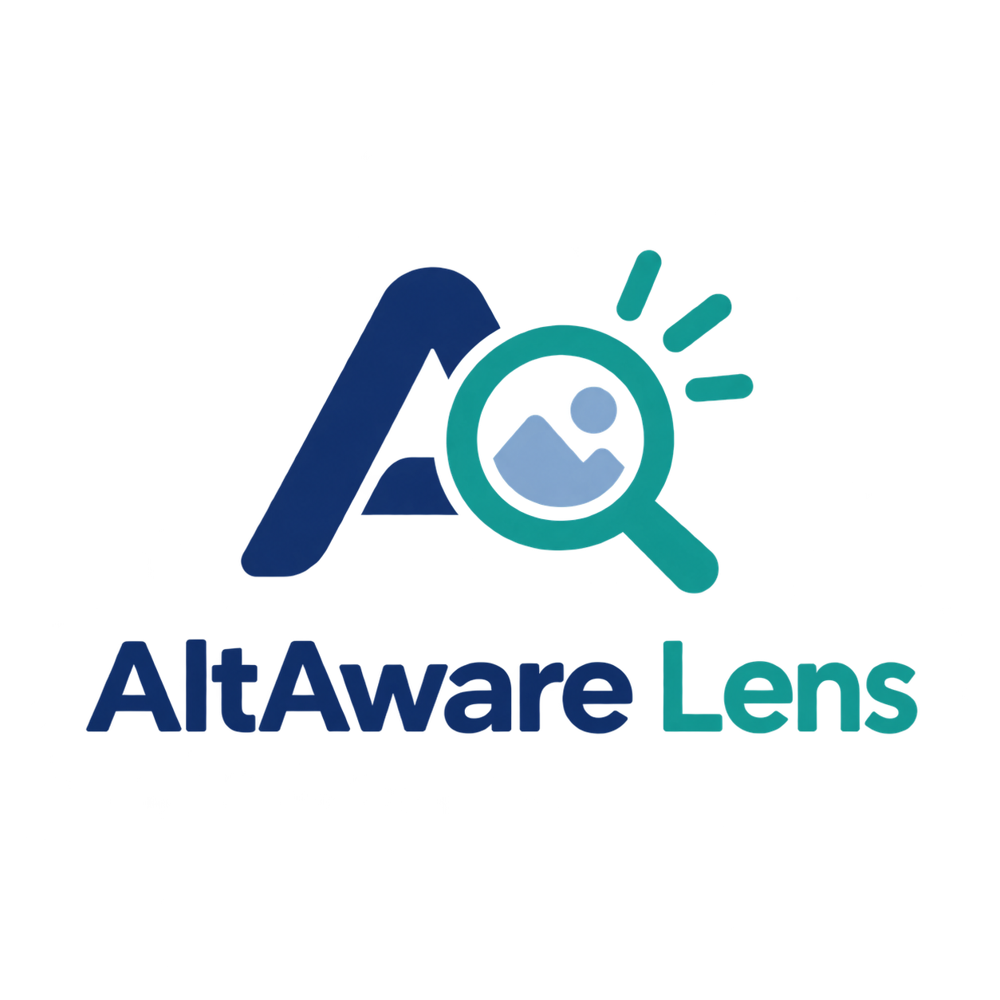
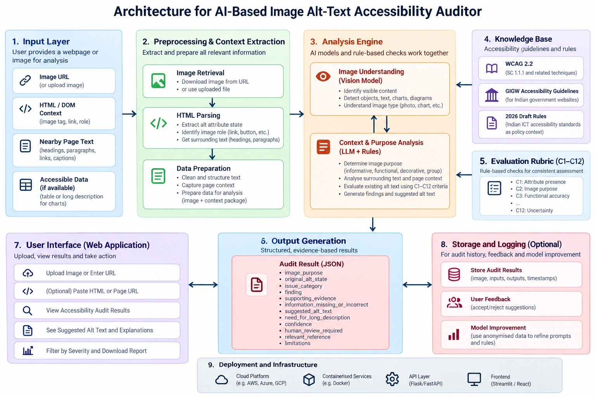

<div align="center">
  

# AltAware Lens
### Context-Aware AI Alt-Text Accessibility Auditor

**Beyond detecting missing alt text — evaluating whether descriptions preserve meaning.**

**Team Mystic Minds** · Hackathon Project
</div>

## The Problem

Images communicate information that people using screen readers may miss when alternative text is absent, vague, inaccurate, or incomplete. A description can exist and still fail to convey what matters.

For example, `alt="Infographic about employment statistics"` identifies the subject but may omit the key figures or comparison that the infographic was designed to communicate.

Traditional automated checks are effective at detecting missing attributes and certain markup problems. Evaluating whether existing descriptions communicate the image's **purpose and essential information** is a more context-dependent challenge.

## Our Solution

**AltAware Lens** is a web-based accessibility auditing project that combines **rule-based checks** with a **Gemma 4–based semantic evaluation stage**. It is designed to inspect website images, consider the surrounding page context, and explain potential weaknesses in their text alternatives.

The goal is to provide actionable findings, not just a pass/fail label or a score. Suggested improvements require human review; the tool does not automatically change the original website.

## Core Workflow

1. **Enter a webpage URL** to begin an audit.
2. **Extract images and context**, including image URLs, existing alt text, and nearby page text.
3. **Run basic checks** for missing, empty, or generic alt attributes.
4. **Evaluate meaning with Gemma 4** to assess purpose, relevance, possible factual errors, and missing essential information.
5. **Present findings** with explanations, potential improvements, and human-review guidance.
6. **Export a report** where supported by the integrated application.

> **Implementation note:** The image extraction and basic-check modules have been tested independently. The final integrated Gemma 4 evaluation, complete reporting workflow, and deployment should be verified before being described as fully operational.

## System Architecture

The following is our team's proposed system architecture, including optional and future components.



The architecture covers input, preprocessing and context extraction, analysis, reference guidance, evaluation criteria, output generation, the web interface, optional storage, and deployment. **Optional storage, user feedback, and infrastructure alternatives shown in the diagram are not claims that all those features have been implemented.**

## Technology Stack

| Component | Technology | Purpose |
|---|---|---|
| Frontend | HTML, CSS, JavaScript | URL entry and audit report interface |
| Backend | Django (Python) | Connect frontend, extraction, rules, and AI assessment |
| Webpage parsing | Requests, Beautiful Soup | Retrieve HTML and extract image information |
| Basic checks | Python | Identify missing, empty, and generic alt text |
| Semantic analysis | Gemma 4 (integration to be verified) | Evaluate image meaning and description quality |
| Version control | Git and GitHub | Collaboration and source management |

## What We Evaluate

AltAware Lens uses a **proposed 12-criterion evaluation rubric** informed by WCAG and W3C guidance. These are **project-specific checks**, not twelve official WCAG success criteria.

| ID | Criterion | Focus |
|---|---|---|
| C1 | Attribute presence | Is the `alt` attribute missing? |
| C2 | Image purpose | Is the image informative, functional, decorative, or uncertain? |
| C3 | Functional accuracy | Does a linked image communicate its destination or action? |
| C4 | Informative meaning | Does the description communicate relevant meaning? |
| C5 | Contextual relevance | Does the text make sense with surrounding content? |
| C6 | Factual accuracy | Does the description contradict or invent details? |
| C7 | Essential information | Are key messages, values, or relationships omitted? |
| C8 | Complex visual support | Is a longer text equivalent needed for a chart or diagram? |
| C9 | Text within images | Is important embedded text conveyed accurately? |
| C10 | Redundancy | Does the description needlessly duplicate nearby text? |
| C11 | Conciseness | Does unnecessary detail obscure the purpose? |
| C12 | Uncertainty | Should the finding be referred for human review? |

### Important accessibility distinctions

- A **missing `alt` attribute** should be flagged for inspection.
- An intentionally **empty `alt=""`** can be correct for decorative or redundant images; it is not automatically a failure.
- A description such as `alt="image"` may be too generic for an informative image.
- A linked image should be assessed for its **function**, not just its visual appearance.
- Complex charts may need an **accessible table or longer text equivalent**, not an excessively long `alt` attribute.
- AI must **not invent figures, labels, or facts**. Uncertain results should be sent for human review.

## Example: What Basic Checks Can Miss

**Illustrative case — employment infographic**

**Existing alt text:**

> “Infographic about employment statistics.”

**Basic check:** An alt attribute is present.

**Potential semantic issue:** The text names the topic but may omit the infographic's central finding, important values, or comparison.

**Recommended approach:** Describe the main takeaway using verified information. If the visual contains substantial data, provide a longer text equivalent or accessible data table.

> This is an **illustrative test case**, not a claimed result from a completed Gemma 4 run. Actual model findings should be verified against a real test image.

## Findings and Reporting

The intended audit output includes:

- Original alt text and image/page context
- Detected issue category and explanation
- Evidence supporting the finding
- Suggested alternative, when supported by the evidence
- Confidence or human-review status
- Relevant accessibility reference

A suggested description should only be generated when supported by the image and available context. Otherwise, the system should indicate that manual review is required.

## Screenshots and Demo

**Application screenshot:** Add a screenshot from the final integrated website here.

**Demo flow:** Enter a URL → inspect extracted images → review basic checks → examine a verified Gemma 4 finding → view or export the audit report.

Do not present an illustrative case as a verified AI result.

## Getting Started

The final project structure and commands must be confirmed after integration. For a typical Django setup:

```bash
# Clone the actual repository URL
# git clone <repository-url>
# cd <repository-folder>

# Create and activate a virtual environment (Windows)
python -m venv venv
venv\Scripts\activate

# Install dependencies once requirements.txt is finalized
pip install -r requirements.txt

# Run the Django application from the folder containing manage.py
python manage.py runserver
```

> **Before publishing:** Replace the commented placeholders with your actual repository link and confirm the dependency list, any model credentials, environment variables, and startup commands. Never commit API keys or secrets.

## Current Scope and Future Enhancements

**MVP focus:** One-page URL scanning, image and alt-text extraction, basic rule checks, Gemma 4 evaluation, and a readable audit report.

**Future direction:**

- Broader coverage of JavaScript-rendered images, SVGs, and complex visual content
- Validation against human-reviewed accessibility test cases
- Longer descriptions backed by accessible source data
- English, Hindi, and Marathi information-consistency evaluation
- Reviewer approval and editing workflows
- Saved audit history and developer workflow integrations

User accounts, dashboards, and persistent audit history are **not required for the core MVP**.

## Limitations and Responsible Use

- Image purpose depends on context and may require human judgment.
- Vision models may misread chart values, labels, and small text.
- Some images are loaded dynamically and may not be found by basic HTML extraction.
- A short description is not automatically inadequate; an empty alternative may be intentional.
- AI findings are recommendations, **not a certification of WCAG or GIGW compliance**.
- Public-site scanning should respect site policies, applicable access restrictions, and reasonable request rates.

## Team Mystic Minds

| Member |
|---|
| Bhavya Bhat |
| Simraa Wasim Parkar |
| Saloni Jamdade |
| Lucky Jangid |

## References

- [WCAG 2.2 — Success Criterion 1.1.1: Non-text Content](https://www.w3.org/TR/WCAG22/#non-text-content)
- [W3C WAI Images Tutorial](https://www.w3.org/WAI/tutorials/images/)
- [W3C WAI Complex Images Tutorial](https://www.w3.org/WAI/tutorials/images/complex/)
- [W3C WAI Alt Decision Tree](https://www.w3.org/WAI/tutorials/images/decision-tree/)
- [Guidelines for Indian Government Websites (GIGW)](https://guidelines.india.gov.in/)
- [WebAIM Million](https://webaim.org/projects/million/)

---

<div align="center">

**Accessibility is not just about describing an image. It's about preserving the information that image was meant to communicate.**

*AltAware Lens · Team Mystic Minds*

</div>
